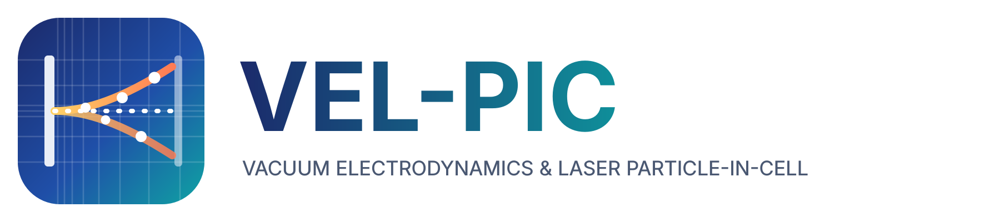
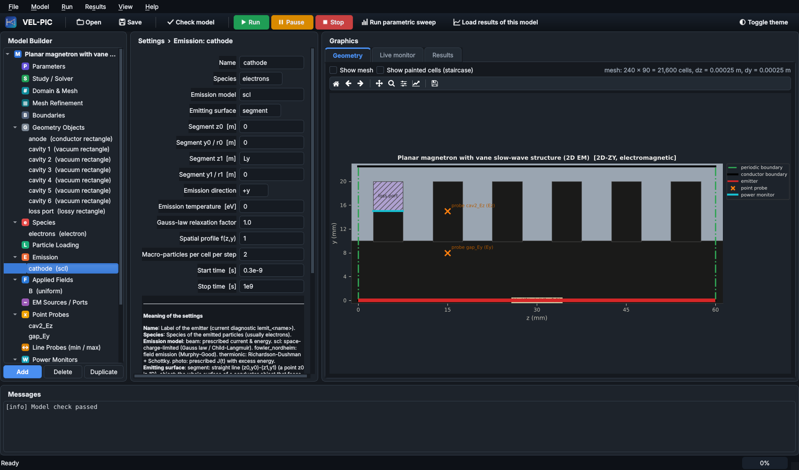
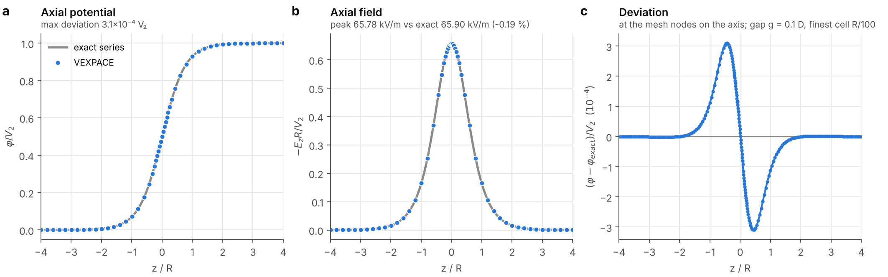
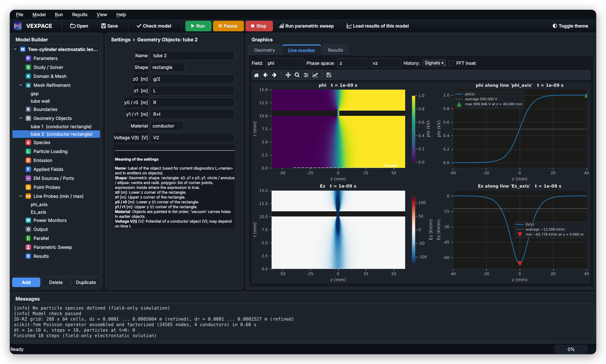
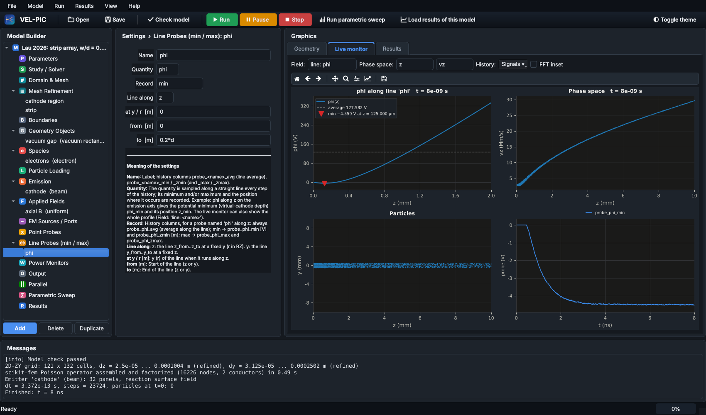
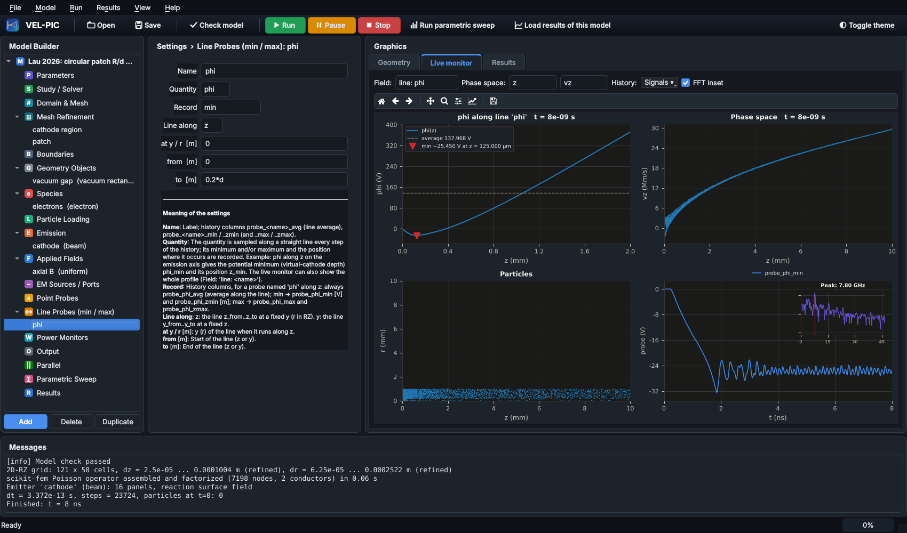
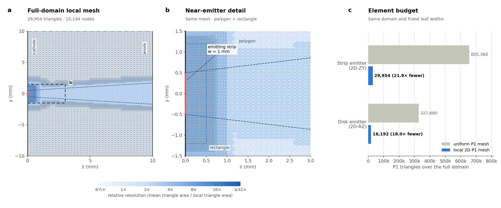
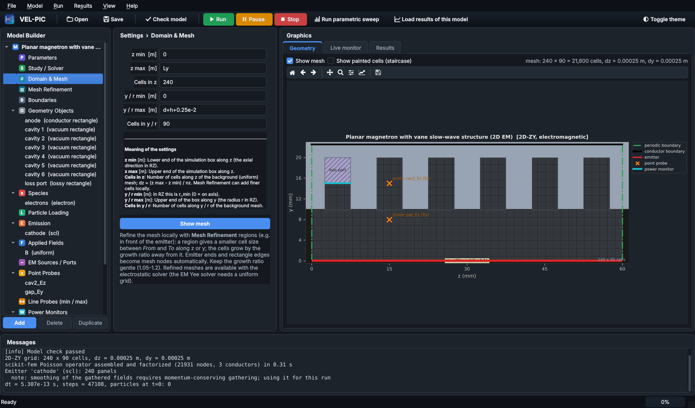
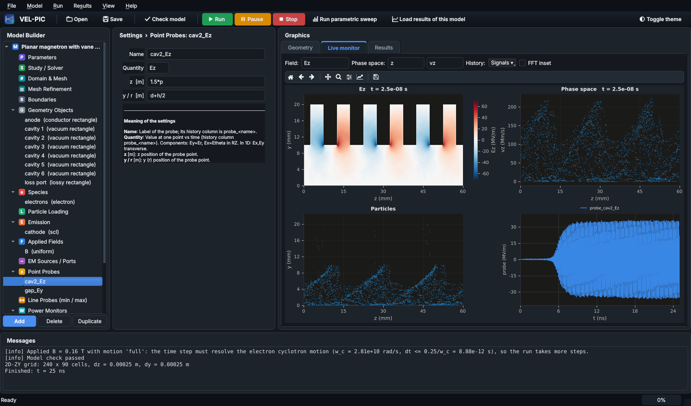

<p align="center"></p>

<h1 align="center">VEL-PIC</h1>
<p align="center"><b>Vacuum Electrodynamics and Laser Particle-in-Cell</b></p>

<p align="center">
<a href="LICENSE"></a>


<a href="https://doi.org/10.5281/zenodo.23512470"></a>
</p>

VEL-PIC is a particle-in-cell (PIC) code for space-charge-limited flow, electron beams, plasmas and vacuum
electron devices. It is written in Python with Numba-compiled kernels and comes with a model-builder
graphical interface, a command-line runner and a Python API.

| Geometry | Electrostatic | Electromagnetic |
|---|---|---|
| **1D-Z** (planar) | finite elements (scikit-fem [[1]](#references), P1) | Yee FDTD, charge-conserving |
| **2D-ZY** (Cartesian, per unit depth) | finite elements (Q1), locally refined meshes | Yee FDTD, all six field components |
| **2D-RZ** (axisymmetric) | finite elements with r-weighted weak form | cylindrical Yee FDTD with exact on-axis update |

<p align="center"></p>

## Features

- **Model builder.** Parameters and expressions in every field, geometry objects (rectangles, circles,
  ellipses, annuli, polygons, implicit shapes) as conductors with V(t), dielectrics, absorbers, resistive
  loads of prescribed Q, or vacuum. Every settings form explains each input.
- **Emission.** Space-charge-limited (Gauss's law), Fowler–Nordheim (Murphy–Good), thermionic
  (Richardson–Dushman with Schottky lowering), photoemission and prescribed beams, from segments or from
  the whole surface of a conductor.
- **Particles.** Boris, Vay and Higuera–Cary pushers; energy- or momentum-conserving gather; species motion
  in the applied fields or confined to one direction (the infinite-magnetic-field limit along z or y).
- **Fields.** Uniform, analytic, coil and solenoid fields; laser antennas, plane waves and TEM ports;
  graded absorbing layers; electrodes held at their potentials in electromagnetic runs.
- **Diagnostics.** Currents on every electrode, point and line probes (minimum, maximum and average along a
  line), Poynting power, field and phase-space snapshots, spectra, beam envelope and emittance, animations.
- **Performance.** Numba-threaded kernels, MPI particle decomposition and parallel parametric sweeps.
- **Validation.** 107 checks against analytic theory, published results and the WarpX code
  ([validation report](benchmarks/results/VALIDATION_REPORT.md)).

## Results

### Field-only electrostatics: two-cylinder lens

VEL-PIC also solves pure electrostatic problems without particles. The example `two_cylinder_lens_rz` is the
classic immersion lens: two coaxial tubes of radius R at V₁ = 0 and V₂ = 1 kV with a gap of 0.1 D, on a mesh
refined at the gap and the tube walls [[2, 3]](#references). Along the axis the potential agrees with the
exact series solution to 3×10⁻⁴ V₂ and the peak field to 0.2 %.

<p align="center"></p>

For a run without particles the live monitor shows the potential map, the line-probe profiles φ(z) and E_z(z)
on the axis, and a second field component.

<p align="center"></p>

### Limiting current of small emitters

Space-charge-limited flow from a strip (2D-ZY) and a disk (2D-RZ) emitter with low injection energy,
Δ·eV₀ = 25 eV at V₀ = 2.5 kV, following Lau, Chernin, Heri & Zhang [[4]](#references). The live monitor shows the potential along
the emitter axis with its minimum marked, the phase space, the particles and the history of the potential
minimum φ_min. The steady limiting-current solver included with VEL-PIC agrees with the paper's POISSON
values to within 0.25 %.

**Below the limit (strip, J = 0.96 J_max).** The flow is steady: φ_min settles at −4.6 V, well above
−Δ·V₀ = −25 V, and the whole current reaches the anode.

<p align="center"></p>

**Above the limit (disk, J = 1.04 J_max).** The potential minimum reaches −Δ·V₀, a virtual cathode forms and
oscillates around φ_min ≈ −25.5 V (FFT inset: peak at 7.8 GHz), and part of the current returns to the cathode.

<p align="center"></p>

Examples: `yylau_2026_strip_caseA_zy` (below the limit) and `yylau_2026_disk_virtual_cathode_rz` (above it); geometry,
normalisation and the limiting-current equation (their Eq. 7) are those of Ref. [[4]](#references).

### Graded mesh for small emitters

The electrostatic solver uses finite elements (scikit-fem [[1]](#references)) on a tensor-product mesh with
graded refinement bands: cells are fine over a small emitter and at the cathode and grow by a set ratio
(1.05–1.2) away from them. Uniform-grid PIC codes such as XOOPIC [[5]](#references) must use the finest cell
everywhere. For the strip emitter above, the graded mesh has 15,972 cells; the same 25 µm × 31 µm resolution on
a uniform grid needs 256,000 cells (16× more), and 9× more for the disk.

Graded meshes are for electrostatic runs only. The Geometry tab draws a refinement region for either solver,
but with the electromagnetic solver the model check reports an error and the run does not start: the Yee time
step is set by the smallest cell over the whole domain, the staggered update is second-order only on equal
cells (graded cells reflect waves), and the charge-conserving deposition and the held-electrode correction
assume equal cells. For electromagnetic runs use a uniform mesh fine enough for the emitter.

<p align="center"></p>

### Planar vane magnetron

A six-cavity planar vane magnetron at 170 kV and 0.16 T. It is a generic design made for VEL-PIC, not a
reproduction of a particular device: the operating point lies between the relativistic planar Hull cutoff
(0.150 T) and the π-mode Buneman–Hartree field (0.180 T) [[6, 7]](#references), and the periodic geometry is the
planar analogue of the recirculating planar magnetron [[8]](#references) (model shown at the top of this page). Space-charge-limited emission from the cathode at y = 0 forms three spokes; the cavity field
grows from noise, locks into the π mode and saturates at about 35 MV/m and 5.70 GHz, 2.4 % below the cold-test
frequency. A resistive load in one cavity sets the loaded Q to 250.

The model: cathode at y = 0 (red, emitting over the full period), anode block with six vane cavities above the
1 cm interaction gap, periodic side boundaries, the loss port in cavity 1 and two field probes, on a uniform
240 × 90 Yee mesh (0.25 mm cells).

<p align="center"></p>

The live monitor at the end of the run (25 ns) shows E_z in the π mode, the phase space, the spokes and the
cavity-2 E_z probe.

<p align="center"></p>

Example: `planar_magnetron_em`.

## Installation

Python 3.9 or newer is required.

```bash
git clone https://github.com/faisal-um-ners/VEL-PIC.git
cd VEL-PIC
pip install -e ".[gui]"          # add ",mpi" for MPI support
```

Installer scripts are also provided: `install/install_mac_linux.sh` (macOS and Linux),
`install/install_windows.bat` (Windows) and the double-click launcher `install/VEL-PIC.command` (macOS).
Kernels are compiled by Numba on first use and cached.

## Usage

```bash
python -m picstudio gui                                   # graphical interface
python -m picstudio run examples/child_langmuir_1d.pic.json
python -m picstudio sweep examples/thermionic_diode_1d.pic.json
mpiexec -n 4 python -m picstudio run model.pic.json --mode mpi
python -m picstudio check model.pic.json                  # validate a model
python -m picstudio info                                  # versions, threads, MPI
```

From Python:

```python
from picstudio import load_model, Simulation

model = load_model("examples/child_langmuir_1d.pic.json")
model["parameters"]["V0"] = "2000"
sim = Simulation(model, out_dir="out")
sim.run()
history, columns = sim.history_array()
```

The Python package is named `picstudio`; model files use the extension `.pic.json`.

## Examples

All examples are in [`examples/`](examples) and under **File → Examples** in the interface.

| Example | Geometry, solver | Physics |
|---|---|---|
| `child_langmuir_1d`, `virtual_cathode_1d` | 1D ES | Child–Langmuir diode; over-injected beam and virtual cathode |
| `child_langmuir_periodic_zy`, `child_langmuir_strip_zy`, `child_langmuir_disk_rz` | ZY / RZ ES | 2D space-charge-limited flow [[9, 10]](#references) |
| `coaxial_diode_rz` | RZ ES | Langmuir–Blodgett radial flow [[11]](#references) |
| `thermionic_diode_1d`, `field_emission_1d` | 1D ES | emission laws with space charge |
| `yylau_2026_strip_caseA_zy`, `yylau_2026_strip_E3_zy`, `yylau_2026_disk_rz` (+ `_virtual_cathode` variants) | ZY / RZ ES, refined mesh | limiting current of small emitters [[4]](#references) |
| `plasma_oscillation_1d`, `landau_damping_1d` | 1D ES | Langmuir oscillation; Landau damping (kλ_D = 0.5) |
| `two_stream_1d`, `beam_plasma_1d`, `beam_plasma_zy` | 1D / ZY ES | streaming instabilities |
| `pierce_diode_1d` | 1D ES | Pierce diode instability [[12]](#references) |
| `beam_expansion_zy`, `beam_drift_tube_rz`, `beam_solenoid_rz` | ZY / RZ ES | space-charge beam expansion; Brillouin focusing |
| `dielectric_charging_zy` | ZY ES | beam charging of a dielectric |
| `two_cylinder_lens_rz` | RZ ES, field only | two-cylinder electrostatic lens [[2, 3]](#references) |
| `planar_magnetron_es` | ZY ES | crossed-field diode, Hull cutoff [[6]](#references) |
| `planar_magnetron_em`, `a6_magnetron_em` | ZY EM | planar vane magnetron [[6–8]](#references); A6 relativistic magnetron [[13, 14]](#references) |
| `relativistic_diode_rz_em` | RZ EM | TEM-port-driven coaxial diode |
| `laser_plasma_1d`, `laser_plasma_zy`, `laser_focus_zy`, `laser_wakefield_1d` | 1D / ZY EM | laser–plasma interaction and focusing |
| `beam_plasma_wakefield_1d`, `plasma_wakefield_rz` | 1D / RZ EM | beam-driven plasma wakefields |

## Validation

`python benchmarks/run_all.py` runs the complete suite and writes
[`benchmarks/results/VALIDATION_REPORT.md`](benchmarks/results/VALIDATION_REPORT.md). Selected results:

| Benchmark | Result |
|---|---|
| Poisson solver, 1D / ZY / RZ | second-order convergence |
| Child–Langmuir law, 1 kV / 100 kV (relativistic) | +1.3 % / +1.5 % |
| 2D strip emitter vs Lau [[10]](#references), W/d = 1–4 | +0.2 … +1.9 % |
| Langmuir–Blodgett coaxial flow [[11]](#references) | +0.6 % |
| Two-cylinder lens, axial potential / peak field [[2, 3]](#references) | 3×10⁻⁴ V₂ / −0.19 % |
| Landau damping, kλ_D = 0.5 (exact Vlasov root) | γ +3.5 %, ω −0.04 % |
| Two-stream / beam–plasma growth rates | −0.25 % / −0.3 % |
| Pierce diode instability [[12]](#references), α = 1.5π / 2.5π | γ −2.1 % / −5.4 % |
| Cavity eigenmodes (TM, TE, RZ) | −0.02 % |
| Electromagnetic charge conservation | 10⁻¹⁵ |
| Limiting current of small emitters vs POISSON [[4]](#references) | +0.06 … +0.24 % |
| Code-to-code with WarpX [[15]](#references): two-stream, Pierce diode, RZ beam, EM wake | 0.04 %, 0.05 %, 1.4 %, 0.06 % |
| Particle pushers vs WarpX (Boris, Vay, Higuera–Cary) | 10⁻⁸ … 10⁻¹⁵ |
| Crossed-field gaps vs WarpX, planar / coaxial | potential ≤ 1.2·10⁻⁴ V₀ / 10⁻⁶ V₀ |
| A6 magnetron at 360 kV, 0.8 T (measured ≈ 2.3 GHz [[13, 14]](#references)) | π mode at 2.16 GHz |

## References

1. T. Gustafsson and G. D. McBain, "scikit-fem: A Python package for finite element assembly,"
   J. Open Source Softw. **5**, 2369 (2020).
2. L. S. Goddard, "Optical characteristics of a two-cylinder electrostatic lens," Math. Proc. Camb. Phil. Soc.
   **42**, 106 (1946).
3. R. D. Cook and D. W. O. Heddle, "The simple accurate calculation of cylinder lens potentials and focal
   properties," J. Phys. E: Sci. Instrum. **9**, 279 (1976).
4. Y. Y. Lau, D. Chernin, M. Heri and P. Zhang, "Solution to an unsolved problem in diodes: limiting current for
   small emission area and low emission energy," [arXiv:2607.24590](https://arxiv.org/abs/2607.24590) (2026).
5. J. P. Verboncoeur, A. B. Langdon and N. T. Gladd, "An object-oriented electromagnetic PIC code,"
   Comput. Phys. Commun. **87**, 199 (1995).
6. Y. Y. Lau, J. W. Luginsland, K. L. Cartwright, D. H. Simon, W. Tang, B. W. Hoff and R. M. Gilgenbach,
   "A re-examination of the Buneman–Hartree condition in a cylindrical smooth-bore relativistic magnetron,"
   Phys. Plasmas **17**, 033102 (2010).
7. R. V. Lovelace and E. Ott, "Theory of magnetic insulation," Phys. Fluids **17**, 1263 (1974).
8. M. Franzi et al., "Recirculating planar magnetron simulations and experiment," IEEE Trans. Plasma Sci. **41** (2013).
9. J. W. Luginsland, Y. Y. Lau and R. M. Gilgenbach, "Two-dimensional Child–Langmuir law,"
   Phys. Rev. Lett. **77**, 4668 (1996).
10. Y. Y. Lau, "Simple theory for the two-dimensional Child–Langmuir law," Phys. Rev. Lett. **87**, 278301 (2001).
11. I. Langmuir and K. B. Blodgett, "Currents limited by space charge between coaxial cylinders,"
    Phys. Rev. **22**, 347 (1923).
12. J. R. Pierce, "Limiting stable current in electron beams in the presence of ions," J. Appl. Phys. **15**, 721 (1944).
13. G. Bekefi and T. Orzechowski, "Giant microwave bursts emitted from a field-emission, relativistic-electron-beam
    magnetron," Phys. Rev. Lett. **37**, 379 (1976).
14. A. Palevsky and G. Bekefi, "Microwave emission from pulsed, relativistic e-beam diodes. II. The
    multiresonator magnetron," Phys. Fluids **22**, 986 (1979).
15. WarpX, [https://github.com/BLAST-WarpX/warpx](https://github.com/BLAST-WarpX/warpx); L. Fedeli et al., "Pushing the
    frontier in the design of laser-based electron accelerators with groundbreaking mesh-refined particle-in-cell
    simulations on exascale-class supercomputers," Proc. SC22 (2022).

## Documentation

- [User guide](docs/USER_GUIDE.md): building, running and post-processing a model.
- [Numerical methods](docs/THEORY.md): mesh, solvers, emission, particle push, parallelisation.
- [Comparison with other codes](docs/COMPARISON.md): feature overview and algorithm-by-algorithm comparison with WarpX.
- [Validation report](benchmarks/results/VALIDATION_REPORT.md).

## Repository layout

```
picstudio/      Python package: model schema, mesh, field solvers, particles, emission, GUI
examples/       ready-to-run models and their generator (make_examples.py)
benchmarks/     validation suite, WarpX comparison scripts and results
docs/           user guide, numerical methods, code comparison, figures
tests/          unit tests (pytest)
install/        installers and launchers
```

## How to cite

If VEL-PIC contributes to published work, please cite it. The software is archived on Zenodo with the
permanent DOI [10.5281/zenodo.23512470](https://doi.org/10.5281/zenodo.23512470), which covers all versions.

> Faisal, M. A. (2026). *VEL-PIC: Vacuum Electrodynamics and Laser Particle-in-Cell code* [Computer software].
> Zenodo. https://doi.org/10.5281/zenodo.23512470

```bibtex
@software{faisal_velpic,
  author    = {Faisal, Md Arifuzzaman},
  title     = {{VEL-PIC}: Vacuum Electrodynamics and Laser Particle-in-Cell code},
  year      = {2026},
  publisher = {Zenodo},
  doi       = {10.5281/zenodo.23512470},
  url       = {https://doi.org/10.5281/zenodo.23512470}
}
```

Citation metadata are also provided in [`CITATION.cff`](CITATION.cff).

## Author

**Md Arifuzzaman Faisal**
Department of Nuclear Engineering and Radiological Sciences, University of Michigan, Ann Arbor, MI, USA

## License

Copyright © 2026 Md Arifuzzaman Faisal. VEL-PIC is released under the [BSD 3-Clause License](LICENSE).

The particle kernels follow the algorithms of [WarpX](https://github.com/BLAST-WarpX/warpx)
(BSD-3-Clause-LBNL); its notice is reproduced in [`THIRD_PARTY_NOTICES.md`](THIRD_PARTY_NOTICES.md).
