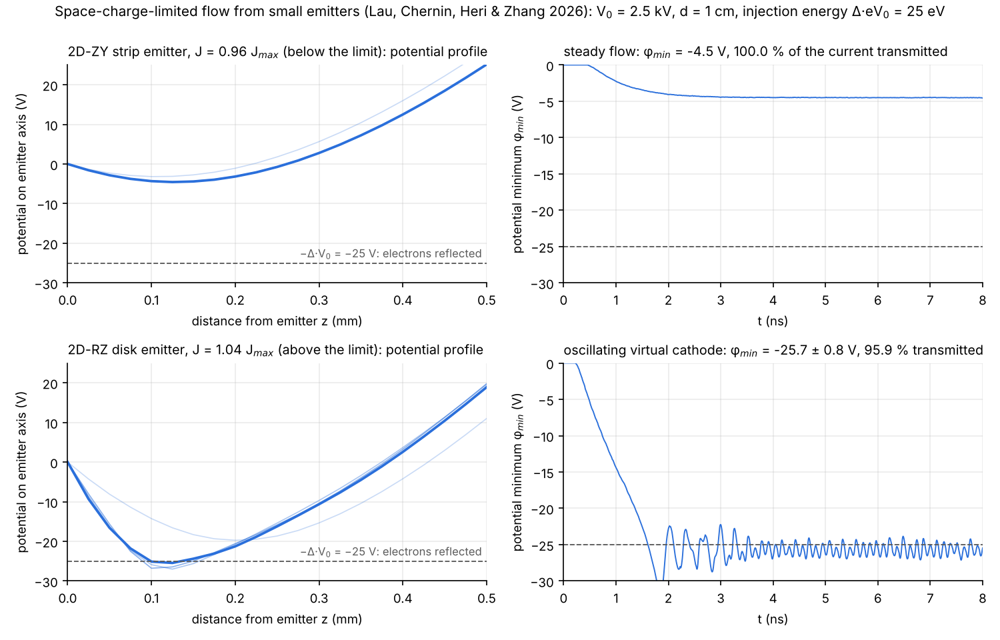
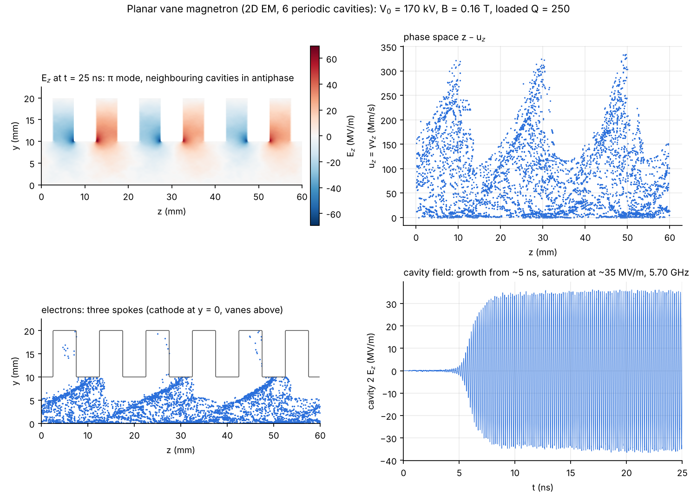

<p align="center"></p>

<h1 align="center">VEL-PIC</h1>
<p align="center"><b>Vacuum Electrodynamics and Laser Particle-in-Cell</b></p>

<p align="center">
<a href="LICENSE"></a>


</p>

VEL-PIC is a particle-in-cell (PIC) code for space-charge-limited flow, electron beams, plasmas and vacuum
electron devices. It is written in Python with Numba-compiled kernels and comes with a model-builder
graphical interface, a command-line runner and a Python API.

| Geometry | Electrostatic | Electromagnetic |
|---|---|---|
| **1D-Z** (planar) | finite elements (scikit-fem, P1) | Yee FDTD, charge-conserving |
| **2D-ZY** (Cartesian, per unit depth) | finite elements (Q1), locally refined meshes | Yee FDTD, all six field components |
| **2D-RZ** (axisymmetric) | finite elements with r-weighted weak form | cylindrical Yee FDTD with exact on-axis update |

<p align="center"></p>

## Features

- **Model builder.** Parameters and expressions in every field, geometry objects (rectangles, circles,
  ellipses, annuli, polygons, implicit shapes) as conductors with V(t), dielectrics, absorbers, resistive
  loads of prescribed Q, or vacuum. Every settings form explains each input.
- **Emission.** Space-charge-limited (Gauss's law), Fowler–Nordheim (Murphy–Good), thermionic
  (Richardson–Dushman with Schottky lowering), photoemission and prescribed beams, from segments or from
  the whole surface of a conductor.
- **Particles.** Boris, Vay and Higuera–Cary pushers; energy- or momentum-conserving gather; species motion
  in the applied fields or confined to one direction (the infinite-magnetic-field limit along z or y).
- **Fields.** Uniform, analytic, coil and solenoid fields; laser antennas, plane waves and TEM ports;
  graded absorbing layers; electrodes held at their potentials in electromagnetic runs.
- **Diagnostics.** Currents on every electrode, point and line probes (minimum, maximum and average along a
  line), Poynting power, field and phase-space snapshots, spectra, beam envelope and emittance, animations.
- **Performance.** Numba-threaded kernels, MPI particle decomposition and parallel parametric sweeps.
- **Validation.** 107 checks against analytic theory, published results and the WarpX code
  ([validation report](benchmarks/results/VALIDATION_REPORT.md)).

## Results

### Limiting current of small emitters

Space-charge-limited flow from a strip (2D-ZY) and a disk (2D-RZ) emitter with low injection energy
(Lau, Chernin, Heri & Zhang 2026). Below the limiting current the flow is steady and the whole current
reaches the anode; above it the potential minimum reaches −Δ·V₀, a virtual cathode forms and oscillates,
and part of the current returns to the cathode. The steady limiting-current solver included with VEL-PIC
agrees with the paper's POISSON values to within 0.25 %.

<p align="center"></p>

Examples: `yylau_2026_strip_caseA_zy` (below the limit) and `yylau_2026_disk_virtual_cathode_rz` (above it).

### Planar vane magnetron

A six-cavity planar magnetron at 170 kV and 0.16 T, inside the Hull–Buneman–Hartree window. Space-charge
limited emission from the cathode at y = 0 forms three spokes; the cavity field grows from noise, locks into
the π mode and saturates at 5.70 GHz, 2.4 % below the cold-test frequency. A resistive load in one cavity
sets the loaded Q to 250.

<p align="center"></p>

Example: `planar_magnetron_em`.

## Installation

Python 3.9 or newer is required.

```bash
git clone https://github.com/faisal-um-ners/VEL-PIC.git
cd VEL-PIC
pip install -e ".[gui]"          # add ",mpi" for MPI support
```

Installer scripts are also provided: `install/install_mac_linux.sh` (macOS and Linux),
`install/install_windows.bat` (Windows) and the double-click launcher `install/VEL-PIC.command` (macOS).
Kernels are compiled by Numba on first use and cached.

## Usage

```bash
python -m picstudio gui                                   # graphical interface
python -m picstudio run examples/child_langmuir_1d.pic.json
python -m picstudio sweep examples/thermionic_diode_1d.pic.json
mpiexec -n 4 python -m picstudio run model.pic.json --mode mpi
python -m picstudio check model.pic.json                  # validate a model
python -m picstudio info                                  # versions, threads, MPI
```

From Python:

```python
from picstudio import load_model, Simulation

model = load_model("examples/child_langmuir_1d.pic.json")
model["parameters"]["V0"] = "2000"
sim = Simulation(model, out_dir="out")
sim.run()
history, columns = sim.history_array()
```

The Python package is named `picstudio`; model files use the extension `.pic.json`.

## Examples

All examples are in [`examples/`](examples) and under **File → Examples** in the interface.

| Example | Geometry, solver | Physics |
|---|---|---|
| `child_langmuir_1d`, `virtual_cathode_1d` | 1D ES | Child–Langmuir diode; over-injected beam and virtual cathode |
| `child_langmuir_periodic_zy`, `child_langmuir_strip_zy`, `child_langmuir_disk_rz` | ZY / RZ ES | 2D space-charge-limited flow (Lau 2001) |
| `coaxial_diode_rz` | RZ ES | Langmuir–Blodgett radial flow |
| `thermionic_diode_1d`, `field_emission_1d` | 1D ES | emission laws with space charge |
| `yylau_2026_strip_caseA_zy`, `yylau_2026_strip_E3_zy`, `yylau_2026_disk_rz` (+ `_virtual_cathode` variants) | ZY / RZ ES, refined mesh | limiting current of small emitters (Lau et al. 2026) |
| `plasma_oscillation_1d`, `landau_damping_1d` | 1D ES | Langmuir oscillation; Landau damping (kλ_D = 0.5) |
| `two_stream_1d`, `beam_plasma_1d`, `beam_plasma_zy` | 1D / ZY ES | streaming instabilities |
| `pierce_diode_1d` | 1D ES | Pierce diode instability |
| `beam_expansion_zy`, `beam_drift_tube_rz`, `beam_solenoid_rz` | ZY / RZ ES | space-charge beam expansion; Brillouin focusing |
| `dielectric_charging_zy` | ZY ES | beam charging of a dielectric |
| `planar_magnetron_es` | ZY ES | crossed-field diode, Hull cutoff |
| `planar_magnetron_em`, `a6_magnetron_em` | ZY EM | planar vane magnetron; A6 relativistic magnetron |
| `relativistic_diode_rz_em` | RZ EM | TEM-port-driven coaxial diode |
| `laser_plasma_1d`, `laser_plasma_zy`, `laser_focus_zy`, `laser_wakefield_1d` | 1D / ZY EM | laser–plasma interaction and focusing |
| `beam_plasma_wakefield_1d`, `plasma_wakefield_rz` | 1D / RZ EM | beam-driven plasma wakefields |

## Validation

`python benchmarks/run_all.py` runs the complete suite and writes
[`benchmarks/results/VALIDATION_REPORT.md`](benchmarks/results/VALIDATION_REPORT.md). Selected results:

| Benchmark | Result |
|---|---|
| Poisson solver, 1D / ZY / RZ | second-order convergence |
| Child–Langmuir law, 1 kV / 100 kV (relativistic) | +1.3 % / +1.5 % |
| 2D strip emitter vs Lau (2001), W/d = 1–4 | +0.2 … +1.9 % |
| Langmuir–Blodgett coaxial flow | +0.6 % |
| Landau damping, kλ_D = 0.5 (exact Vlasov root) | γ +3.5 %, ω −0.04 % |
| Two-stream / beam–plasma growth rates | −0.25 % / −0.3 % |
| Pierce diode instability, α = 1.5π / 2.5π | γ −2.1 % / −5.4 % |
| Cavity eigenmodes (TM, TE, RZ) | −0.02 % |
| Electromagnetic charge conservation | 10⁻¹⁵ |
| Limiting current of small emitters vs POISSON (Lau et al. 2026) | +0.06 … +0.24 % |
| Code-to-code with WarpX: two-stream, Pierce diode, RZ beam, EM wake | 0.04 %, 0.05 %, 1.4 %, 0.06 % |
| Particle pushers vs WarpX (Boris, Vay, Higuera–Cary) | 10⁻⁸ … 10⁻¹⁵ |
| Crossed-field gaps vs WarpX, planar / coaxial | potential ≤ 1.2·10⁻⁴ V₀ / 10⁻⁶ V₀ |
| A6 magnetron at 360 kV, 0.8 T (measured ≈ 2.3 GHz) | π mode at 2.16 GHz |

## Documentation

- [User guide](docs/USER_GUIDE.md): building, running and post-processing a model.
- [Numerical methods](docs/THEORY.md): mesh, solvers, emission, particle push, parallelisation.
- [Comparison with other codes](docs/COMPARISON.md): feature overview and algorithm-by-algorithm comparison with WarpX.
- [Validation report](benchmarks/results/VALIDATION_REPORT.md).

## Repository layout

```
picstudio/      Python package: model schema, mesh, field solvers, particles, emission, GUI
examples/       ready-to-run models and their generator (make_examples.py)
benchmarks/     validation suite, WarpX comparison scripts and results
docs/           user guide, numerical methods, code comparison, figures
tests/          unit tests (pytest)
install/        installers and launchers
```

## How to cite

If VEL-PIC contributes to published work, please cite it:

> Md Arifuzzaman Faisal, *VEL-PIC: Vacuum Electrodynamics and Laser Particle-in-Cell code*, version 1.3.0 (2026),
> https://github.com/faisal-um-ners/VEL-PIC

```bibtex
@software{faisal_velpic,
  author  = {Md Arifuzzaman Faisal},
  title   = {{VEL-PIC}: Vacuum Electrodynamics and Laser Particle-in-Cell code},
  version = {1.3.0},
  year    = {2026},
  url     = {https://github.com/faisal-um-ners/VEL-PIC}
}
```

Citation metadata is also provided in [`CITATION.cff`](CITATION.cff).

## Author

**Md Arifuzzaman Faisal**
Department of Nuclear Engineering and Radiological Sciences, University of Michigan, Ann Arbor, MI, USA

## License

Copyright © 2026 Md Arifuzzaman Faisal. VEL-PIC is released under the [BSD 3-Clause License](LICENSE).

The particle kernels follow the algorithms of [WarpX](https://github.com/BLAST-WarpX/warpx)
(BSD-3-Clause-LBNL); its notice is reproduced in [`THIRD_PARTY_NOTICES.md`](THIRD_PARTY_NOTICES.md).
