# VEL-PIC - Validation report

Generated by `benchmarks/run_all.py`. Each benchmark compares VEL-PIC with an analytic result, a published law or another code (WarpX).

**107 / 107 checks passed.**

| # | Benchmark | Case | VEL-PIC | Reference | Error | Status |
|---|---|---|---|---|---|---|
| 01 | Poisson (scikit-fem) convergence: manufactured & analytic solutions | 1D-Z: convergence order | 2.0009 | 2 | +0.04 % | PASS |
| 01 | Poisson (scikit-fem) convergence: manufactured & analytic solutions | 2D-ZY: convergence order | 2.0022 | 2 | +0.11 % | PASS |
| 01 | Poisson (scikit-fem) convergence: manufactured & analytic solutions | 2D-RZ: convergence order | 1.9315 | 2 | -3.42 % | PASS |
| 01 | Poisson (scikit-fem) convergence: manufactured & analytic solutions | coax RZ: convergence order | 1.9955 | 2 | -0.22 % | PASS |
| 01 | Poisson (scikit-fem) convergence: manufactured & analytic solutions | dielectric interface (exact for P1): max error | 5.8732e-15 | 0 | 5.87e-15 | PASS |
| 02 | Child-Langmuir law, planar 1D (non-relativistic & relativistic) | V = 1 kV, J_anode / J_CL | 1.0134 | 1 | +1.34 % | PASS |
| 02 | Child-Langmuir law, planar 1D (non-relativistic & relativistic) | V = 100 kV, J_anode / relativistic CL (Jory-Trivelpiece) | 1.015 | 1 | +1.50 % | PASS |
| 03 | 2D Child-Langmuir: finite strip (ZY) and disk (RZ) emitters | strip W/d = 1: J/J_CL vs Lau (2001) | 1.3163 | 1.3141 | +0.17 % | PASS |
| 03 | 2D Child-Langmuir: finite strip (ZY) and disk (RZ) emitters | strip W/d = 2: J/J_CL vs Lau (2001) | 1.1718 | 1.1571 | +1.27 % | PASS |
| 03 | 2D Child-Langmuir: finite strip (ZY) and disk (RZ) emitters | strip W/d = 4: J/J_CL vs Lau (2001) | 1.0991 | 1.0786 | +1.90 % | PASS |
| 03 | 2D Child-Langmuir: finite strip (ZY) and disk (RZ) emitters | disk R/d = 1: J/J_CL vs Lau 1+d/4R (approx.) | 1.3324 | 1.25 | +6.59 % | PASS |
| 03 | 2D Child-Langmuir: finite strip (ZY) and disk (RZ) emitters | disk R/d = 4: J/J_CL vs Lau 1+d/4R (approx.) | 1.1002 | 1.0625 | +3.55 % | PASS |
| 04 | Radial SCL flow in a coaxial diode (RZ) vs Langmuir-Blodgett | b/a = 2: current per length (A/m) | 835.2 | 830.22 | +0.60 % | PASS |
| 04 | Radial SCL flow in a coaxial diode (RZ) vs Langmuir-Blodgett | b/a = 4: current per length (A/m) | 174.42 | 173.35 | +0.61 % | PASS |
| 05 | Cold plasma oscillation frequency (ES & EM, 1D/ZY/RZ) | 1D-Z ES: w / w_p | 0.99882 | 1 | -0.12 % | PASS |
| 05 | Cold plasma oscillation frequency (ES & EM, 1D/ZY/RZ) | 2D-ZY ES: w / w_p | 0.99881 | 1 | -0.12 % | PASS |
| 05 | Cold plasma oscillation frequency (ES & EM, 1D/ZY/RZ) | 2D-RZ ES: w / w_p | 0.99882 | 1 | -0.12 % | PASS |
| 05 | Cold plasma oscillation frequency (ES & EM, 1D/ZY/RZ) | 1D-Z EM: w / w_p | 0.99943 | 1 | -0.06 % | PASS |
| 05 | Cold plasma oscillation frequency (ES & EM, 1D/ZY/RZ) | 2D-ZY EM: w / w_p | 1.0001 | 1 | +0.01 % | PASS |
| 06 | Two-stream instability growth rate (1D ES) | growth rate gamma / w_pb | 0.49877 | 0.5 | -0.25 % | PASS |
| 07 | Beam-plasma instability growth rate (1D ES) | growth rate gamma / w_p | 0.065824 | 0.066007 | -0.28 % | PASS |
| 08 | Thermionic and Fowler-Nordheim emission with self-consistent space charge | thermionic, V=3 kV (T-limited): J / J_RDS | 0.99798 | 1 | -0.20 % | PASS |
| 08 | Thermionic and Fowler-Nordheim emission with self-consistent space charge | thermionic, V=30 V (SCL): J / Langmuir thermal-SCL estimate | 1.0612 | 1 | +6.12 % | PASS |
| 08 | Thermionic and Fowler-Nordheim emission with self-consistent space charge | Fowler-Nordheim F = 3.0e+09 V/m: J / J_FN | 0.99974 | 1 | -0.03 % | PASS |
| 08 | Thermionic and Fowler-Nordheim emission with self-consistent space charge | Fowler-Nordheim F = 4.0e+09 V/m: J / J_FN | 0.99774 | 1 | -0.23 % | PASS |
| 09 | Hull cutoff in a planar crossed-field diode (ZY, magnetized) | J_anode/J_CL at B = 0.85 B_H (must conduct, >0.3) | 0.86278 | 1 | -13.72 % | PASS |
| 09 | Hull cutoff in a planar crossed-field diode (ZY, magnetized) | J_anode/J_CL at B = 1.05 B_H (cut off, <0.02) | -0 | 0 | -0.00e+00 | PASS |
| 10 | EM cavity eigenfrequencies (Yee FDTD, RZ and ZY) | RZ pillbox TM010 frequency (GHz) | 2.2944 | 2.2949 | -0.02 % | PASS |
| 10 | EM cavity eigenfrequencies (Yee FDTD, RZ and ZY) | RZ pillbox TM011 frequency (GHz) | 4.3936 | 4.3942 | -0.01 % | PASS |
| 10 | EM cavity eigenfrequencies (Yee FDTD, RZ and ZY) | ZY rectangular cavity TMx 1,1 frequency (GHz) | 4.5035 | 4.5038 | -0.01 % | PASS |
| 10 | EM cavity eigenfrequencies (Yee FDTD, RZ and ZY) | ZY rectangular cavity TEx 2,1 frequency (GHz) | 6.2451 | 6.2457 | -0.01 % | PASS |
| 11 | Graded absorbing boundary performance | 1D-Z: residual energy after absorption / peak | 1.2026e-07 | 0 | 1.20e-07 | PASS |
| 11 | Graded absorbing boundary performance | 2D-ZY: residual energy after absorption / peak | 3.3087e-07 | 0 | 3.31e-07 | PASS |
| 12 | Charge conservation of the EM current deposition (Esirkepov) | 1D-Z: change of (rho/eps0 - div E) / max|div E| over 100 steps | 7.2804e-15 | 0 | 7.28e-15 | PASS |
| 12 | Charge conservation of the EM current deposition (Esirkepov) | 2D-ZY: change of (rho/eps0 - div E) / max|div E| over 100 steps | 2.0406e-14 | 0 | 2.04e-14 | PASS |
| 12 | Charge conservation of the EM current deposition (Esirkepov) | 2D-RZ: change of (rho/eps0 - div E) / max|div E| over 100 steps | 2.1199e-11 | 0 | 2.12e-11 | PASS |
| 13 | Laser propagation in plasma: dispersion and critical-density reflection | underdense n = 0.5 n_c: group velocity / c | 0.70926 | 0.70711 | +0.30 % | PASS |
| 13 | Laser propagation in plasma: dispersion and critical-density reflection | overdense n = 4 n_c: reflected / incident energy | 0.99968 | 1 | -0.03 % | PASS |
| 14 | Relativistic beam-driven plasma wakefield amplitude (1D EM) | wake amplitude / linear theory | 1.0466 | 1 | +4.66 % | PASS |
| 15 | Space-charge beam transport (RZ): drift expansion & Brillouin solenoid | drift tube: max |a_PIC/a_envelope - 1| over z | 0.010261 | 0 | 1.03e-02 | PASS |
| 15 | Space-charge beam transport (RZ): drift expansion & Brillouin solenoid | solenoid (Brillouin): max |a_PIC/a_envelope - 1| over z | 0.05745 | 0 | 5.74e-02 | PASS |
| 16 | WarpX comparison A: 1D ES two-stream instability | growth rate gamma/w_pb  (WarpX reference) | 0.49877 | 0.49858 | +0.04 % | PASS |
| 16 | WarpX comparison A: 1D ES two-stream instability | saturated field energy (WarpX reference) | 3.119e-07 | 2.9885e-07 | +4.37 % | PASS |
| 17 | WarpX comparison B: 1D ES Pierce diode injected at J_CL | max |phi_PIC - phi_WarpX| / V | 0.00054878 | 0 | 5.49e-04 | PASS |
| 17 | WarpX comparison B: 1D ES Pierce diode injected at J_CL | max |phi_PIC - phi_theory| / V | 0.0028253 | 0 | 2.83e-03 | PASS |
| 18 | WarpX comparison C: RZ ES space-charge beam expansion | max |a_PIC/a_WarpX - 1| over z | 0.014078 | 0 | 1.41e-02 | PASS |
| 19 | WarpX comparison D: 1D EM beam-driven plasma wakefield | max |Ez_PIC - Ez_WarpX| / E_lin behind bunch | 0.00058688 | 0 | 5.87e-04 | PASS |
| 19 | WarpX comparison D: 1D EM beam-driven plasma wakefield | wake amplitude PIC / WarpX | 1.0065e+09 | 1.0066e+09 | -0.01 % | PASS |
| 20 | Parallel speed-up (numba threads / MPI), 2-core machine | threads=2: speed-up over 1 thread (ideal 2) | 1.4379 | 2 | -28.11 % | PASS |
| 20 | Parallel speed-up (numba threads / MPI), 2-core machine | MPI 2 ranks x 1 thread: speed-up over 1 thread (ideal 2) | 1.8809 | 2 | -5.95 % | PASS |
| 21 | Vaned magnetrons (2D EM): A6 experiment and Hull / Buneman-Hartree window | A6 (360 kV, 0.8 T): fundamental / cold-test pi-mode frequency (oscillates in the pi mode) | 0.93189 | 1 | -6.81 % | PASS |
| 21 | Vaned magnetrons (2D EM): A6 experiment and Hull / Buneman-Hartree window | A6: fundamental vs measured ~2.3 GHz (Palevsky & Bekefi 1979) | 0.93715 | 1 | -6.28 % | PASS |
| 21 | Vaned magnetrons (2D EM): A6 experiment and Hull / Buneman-Hartree window | planar, inside Hull-BH window: fundamental / cold-test pi mode | 0.97614 | 1 | -2.39 % | PASS |
| 21 | Vaned magnetrons (2D EM): A6 experiment and Hull / Buneman-Hartree window | planar, B above the BH field: cavity field rms / in-window rms (quiet, < 0.1) | 0.0044828 | 0 | 4.48e-03 | PASS |
| 22 | Relativistic beam self-fields: EM vs ES+self-B vs envelope (RZ) | EM: max |a/a_envelope - 1| (z < 15 cm) | 0.089819 | 0 | 8.98e-02 | PASS |
| 22 | Relativistic beam self-fields: EM vs ES+self-B vs envelope (RZ) | ES+self-B: max |a/a_envelope - 1| (z < 15 cm) | 0.014358 | 0 | 1.44e-02 | PASS |
| 23 | Loss port with defined loaded Q (cold-test ring-down) | Planar magnetron: loaded Q of the loss port (target 250) | 246.32 | 250 | -1.47 % | PASS |
| 23 | Loss port with defined loaded Q (cold-test ring-down) | A6 magnetron: loaded Q of the loss port (target 250) | 252.96 | 250 | +1.18 % | PASS |
| 23 | Loss port with defined loaded Q (cold-test ring-down) | A6 cold-test pi-mode frequency (GHz) vs ~2.34 GHz (literature) | 2.3123 | 2.34 | -1.18 % | PASS |
| 24 | Lau et al. 2026: limiting current of small emitters (steady Eq. 7) | strip E1 (w/d=0.1, p/d=5.12, Delta=0.01) vs paper POISSON | 5.2034 | 5.191 | +0.24 % | PASS |
| 24 | Lau et al. 2026: limiting current of small emitters (steady Eq. 7) | strip E2 (w/d=0.05, p/d=2.56, Delta=0.001) vs paper POISSON | 4.8321 | 4.829 | +0.06 % | PASS |
| 24 | Lau et al. 2026: limiting current of small emitters (steady Eq. 7) | strip E3 (w/d=0.01, p/d=2.048, Delta=0.01) vs paper POISSON | 32.902 | 32.863 | +0.12 % | PASS |
| 24 | Lau et al. 2026: limiting current of small emitters (steady Eq. 7) | strip E5 (w/d=0.01, p/d=2.048, Delta=0.0001) vs paper POISSON | 9.2373 | 9.226 | +0.12 % | PASS |
| 24 | Lau et al. 2026: limiting current of small emitters (steady Eq. 7) | strip E6 (w/d=0.01, p/d=2.048, Delta=1e-05) vs paper POISSON | 7.8308 | 7.824 | +0.09 % | PASS |
| 24 | Lau et al. 2026: limiting current of small emitters (steady Eq. 7) | strip w/d=0.01, p/d=0.5, Delta=0.01 (packing table <J>=0.446) | 30.078 | 30.087 | -0.03 % | PASS |
| 24 | Lau et al. 2026: limiting current of small emitters (steady Eq. 7) | disk R/d=0.1, Delta=1e-5 vs tutorial (2.723) | 2.6663 | 2.723 | -2.08 % | PASS |
| 24 | Lau et al. 2026: limiting current of small emitters (steady Eq. 7) | disk: self-consistent / first-order Eq.(B10) (tutorial 0.62) | 0.62816 | 0.62 | +1.32 % | PASS |
| 25 | Lau et al. 2026: PIC onset of the virtual cathode at the steady J_max | PIC strip w/d=0.1, J = 0.96 J_max: transmitted fraction | 0.99999 | 1 | -0.00 % | PASS |
| 25 | Lau et al. 2026: PIC onset of the virtual cathode at the steady J_max | PIC strip w/d=0.1, J = 1.04 J_max: returned fraction (> 2 %) | 0.088541 | 0 | 8.85e-02 | PASS |
| 25 | Lau et al. 2026: PIC onset of the virtual cathode at the steady J_max | PIC disk R/d=0.1, J = 0.96 J_max: transmitted fraction | 0.99977 | 1 | -0.02 % | PASS |
| 25 | Lau et al. 2026: PIC onset of the virtual cathode at the steady J_max | PIC disk R/d=0.1, J = 1.04 J_max: returned fraction (> 2 %) | 0.04101 | 0 | 4.10e-02 | PASS |
| 26 | Particle pushers: identical to WarpX (Boris, Vay, Higuera-Cary) | gyro, boris: max |VEL-PIC - WarpX| / path size | 2.3488e-08 | 0 | 2.35e-08 | PASS |
| 26 | Particle pushers: identical to WarpX (Boris, Vay, Higuera-Cary) | gyro, vay: max |VEL-PIC - WarpX| / path size | 2.3488e-08 | 0 | 2.35e-08 | PASS |
| 26 | Particle pushers: identical to WarpX (Boris, Vay, Higuera-Cary) | gyro, higuera: max |VEL-PIC - WarpX| / path size | 2.3488e-08 | 0 | 2.35e-08 | PASS |
| 26 | Particle pushers: identical to WarpX (Boris, Vay, Higuera-Cary) | exb, boris: max |VEL-PIC - WarpX| / path size | 1.3156e-09 | 0 | 1.32e-09 | PASS |
| 26 | Particle pushers: identical to WarpX (Boris, Vay, Higuera-Cary) | exb, vay: max |VEL-PIC - WarpX| / path size | 1.3156e-09 | 0 | 1.32e-09 | PASS |
| 26 | Particle pushers: identical to WarpX (Boris, Vay, Higuera-Cary) | exb, higuera: max |VEL-PIC - WarpX| / path size | 1.3156e-09 | 0 | 1.32e-09 | PASS |
| 26 | Particle pushers: identical to WarpX (Boris, Vay, Higuera-Cary) | relexb, boris: max |VEL-PIC - WarpX| / path size | 5.444e-13 | 0 | 5.44e-13 | PASS |
| 26 | Particle pushers: identical to WarpX (Boris, Vay, Higuera-Cary) | relexb, vay: max |VEL-PIC - WarpX| / path size | 2.5492e-15 | 0 | 2.55e-15 | PASS |
| 26 | Particle pushers: identical to WarpX (Boris, Vay, Higuera-Cary) | relexb, higuera: max |VEL-PIC - WarpX| / path size | 2.5492e-15 | 0 | 2.55e-15 | PASS |
| 26 | Particle pushers: identical to WarpX (Boris, Vay, Higuera-Cary) | Boris gyro-frequency vs (2/dt) atan(w_c dt/2) | 1.7579e+10 | 1.7576e+10 | +0.02 % | PASS |
| 26 | Particle pushers: identical to WarpX (Boris, Vay, Higuera-Cary) | E x B drift velocity vs E/B | 1.0069e+06 | 1e+06 | +0.69 % | PASS |
| 26 | Particle pushers: identical to WarpX (Boris, Vay, Higuera-Cary) | relativistic E x B (gamma=20), vay: transverse deviation / path | 4.9569e-16 | 0 | 4.96e-16 | PASS |
| 26 | Particle pushers: identical to WarpX (Boris, Vay, Higuera-Cary) | relativistic E x B (gamma=20), higuera: transverse deviation / path | 7.0187e-19 | 0 | 7.02e-19 | PASS |
| 27 | Landau damping and thermal Langmuir dispersion (1D ES) | Landau damping k lambda_D = 0.5: damping rate gamma / w_p | -0.15878 | -0.15336 | +3.53 % | PASS |
| 27 | Landau damping and thermal Langmuir dispersion (1D ES) | Landau damping k lambda_D = 0.5: frequency w / w_p | 1.4151 | 1.4157 | -0.04 % | PASS |
| 27 | Landau damping and thermal Langmuir dispersion (1D ES) | thermal Langmuir wave k lambda_D = 0.3: w / w_p (exact Vlasov root) | 1.1614 | 1.1598 | +0.13 % | PASS |
| 28 | Electromagnetic wave dispersion in a cold plasma (1D EM) | EM wave in plasma, ck = 1 w_p: w / sqrt(w_p^2 + c^2 k^2) | 1 | 1 | +0.00 % | PASS |
| 28 | Electromagnetic wave dispersion in a cold plasma (1D EM) | EM wave in plasma, ck = 2 w_p: w / sqrt(w_p^2 + c^2 k^2) | 0.99999 | 1 | -0.00 % | PASS |
| 29 | Energy conservation of a thermal plasma (1D EM, dz = lambda_D) | energy-conserving gather: total energy change after 300/w_p | 2.1533e-05 | 0 | 2.15e-05 | PASS |
| 29 | Energy conservation of a thermal plasma (1D EM, dz = lambda_D) | energy-conserving + 1-pass J filter (WarpX defaults): total energy change | -0.00024396 | 0 | -2.44e-04 | PASS |
| 30 | WarpX comparison E: planar smooth-bore magnetron gap (2D), below / above Hull cutoff | B = 0.6 B_H (conducting): max |phi_VEL-PIC - phi_WarpX| / V | 4.5677e-07 | 0 | 4.57e-07 | PASS |
| 30 | WarpX comparison E: planar smooth-bore magnetron gap (2D), below / above Hull cutoff | B = 0.6 B_H (conducting): electrons in the gap, VEL-PIC / WarpX | 0.99996 | 1 | -0.00 % | PASS |
| 30 | WarpX comparison E: planar smooth-bore magnetron gap (2D), below / above Hull cutoff | B = 1.3 B_H (insulated): max |phi_VEL-PIC - phi_WarpX| / V | 0.00011735 | 0 | 1.17e-04 | PASS |
| 30 | WarpX comparison E: planar smooth-bore magnetron gap (2D), below / above Hull cutoff | B = 1.3 B_H (insulated): electrons in the gap, VEL-PIC / WarpX | 1.0002 | 1 | +0.02 % | PASS |
| 31 | WarpX comparison F: cylindrical smooth-bore magnetron gap (RZ), below / above Hull cutoff | B = 0.6 B* (conducting): max |phi_VEL-PIC - phi_WarpX| / V | 7.4264e-07 | 0 | 7.43e-07 | PASS |
| 31 | WarpX comparison F: cylindrical smooth-bore magnetron gap (RZ), below / above Hull cutoff | B = 0.6 B* (conducting): electrons in the gap, VEL-PIC / WarpX | 1.0001 | 1 | +0.01 % | PASS |
| 31 | WarpX comparison F: cylindrical smooth-bore magnetron gap (RZ), below / above Hull cutoff | B = 1.3 B* (insulated): max |phi_VEL-PIC - phi_WarpX| / V | 6.7723e-07 | 0 | 6.77e-07 | PASS |
| 31 | WarpX comparison F: cylindrical smooth-bore magnetron gap (RZ), below / above Hull cutoff | B = 1.3 B* (insulated): electrons in the gap, VEL-PIC / WarpX | 1 | 1 | +0.00 % | PASS |
| 32 | Pierce diode instability (1D ES, planar) vs the exact dispersion relation | Pierce diode alpha = 1.5 pi: growth rate (v0/L) vs exact dispersion root | 0.74935 | 0.76575 | -2.14 % | PASS |
| 32 | Pierce diode instability (1D ES, planar) vs the exact dispersion relation | Pierce diode alpha = 2.5 pi: growth rate (v0/L) vs exact dispersion root | 0.55724 | 0.58916 | -5.42 % | PASS |
| 32 | Pierce diode instability (1D ES, planar) vs the exact dispersion relation | Pierce diode alpha = 2.5 pi: oscillation frequency (v0/L) | 1.413 | 1.4289 | -1.11 % | PASS |
| 33 | Cylindrical Hull cutoff of a smooth-bore (coaxial) magnetron diode (RZ) | B = 0.95 B*: anode current / B = 0 current (conducting, > 0.3) | 0.75519 | 1 | -24.48 % | PASS |
| 33 | Cylindrical Hull cutoff of a smooth-bore (coaxial) magnetron diode (RZ) | B = 1.05 B*: anode current / B = 0 current (insulated, < 0.02) | -0 | 0 | -0.00e+00 | PASS |
| 34 | Space-charge-limited emission with the EM (Yee) solver: planar and cylindrical | EM 1D Child-Langmuir, 100 cells: J_anode / J (relativistic CL) | 1.031 | 1 | +3.10 % | PASS |
| 34 | Space-charge-limited emission with the EM (Yee) solver: planar and cylindrical | EM 1D Child-Langmuir, 200 cells: J_anode / J (relativistic CL) | 1.0194 | 1 | +1.94 % | PASS |
| 34 | Space-charge-limited emission with the EM (Yee) solver: planar and cylindrical | EM coaxial diode (b/a = 2, 100 cells): I/L vs Langmuir-Blodgett | 1.0324 | 1 | +3.24 % | PASS |

## 01. Poisson (scikit-fem) convergence: manufactured & analytic solutions

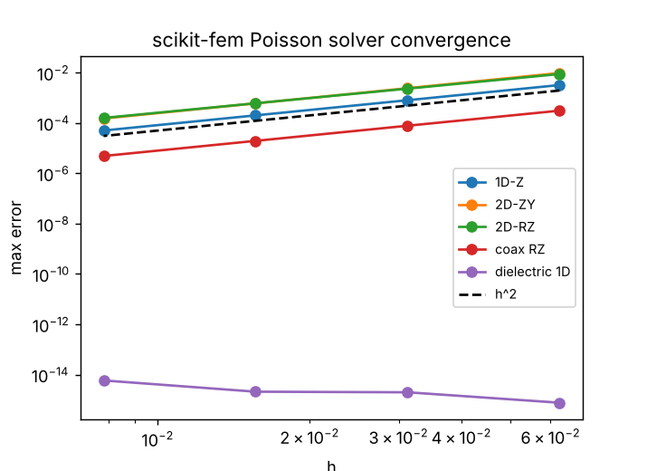

## 02. Child-Langmuir law, planar 1D (non-relativistic & relativistic)

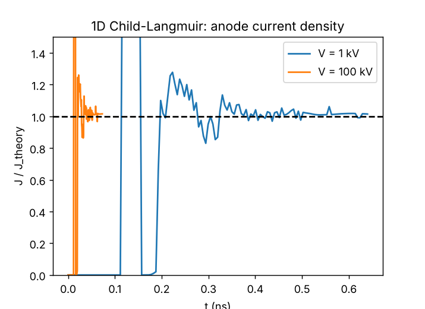

## 03. 2D Child-Langmuir: finite strip (ZY) and disk (RZ) emitters

Electrons confined to z (motion = z_only, infinite axial B) as assumed by Luginsland et al. (1996) and Lau (2001). Lau's disk formula is an approximation (valid for d/R < 2 to a few %); the strip law fits PIC data closely.

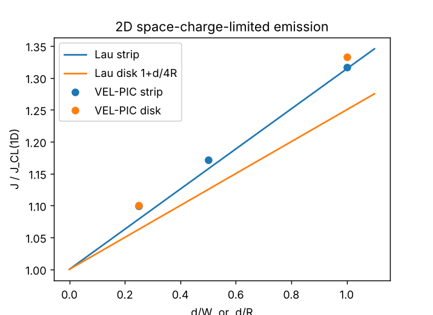

## 04. Radial SCL flow in a coaxial diode (RZ) vs Langmuir-Blodgett

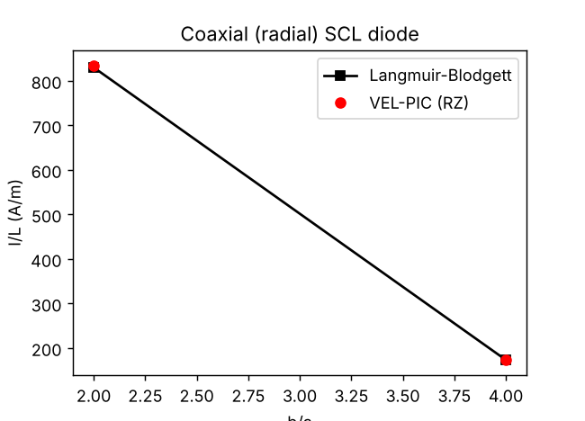

## 05. Cold plasma oscillation frequency (ES & EM, 1D/ZY/RZ)

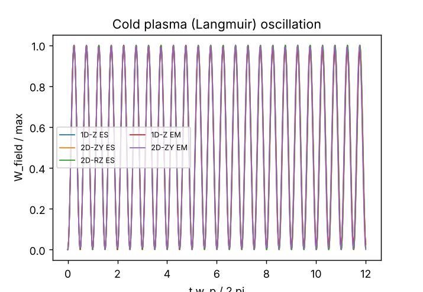

## 06. Two-stream instability growth rate (1D ES)

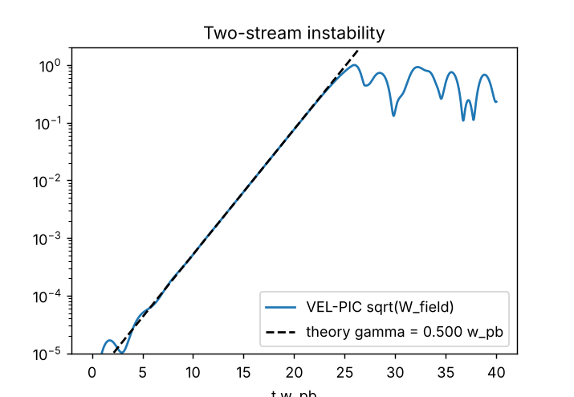

## 07. Beam-plasma instability growth rate (1D ES)

weak-beam asymptote sqrt(3)/2^(4/3) alpha^(1/3) = 0.0687

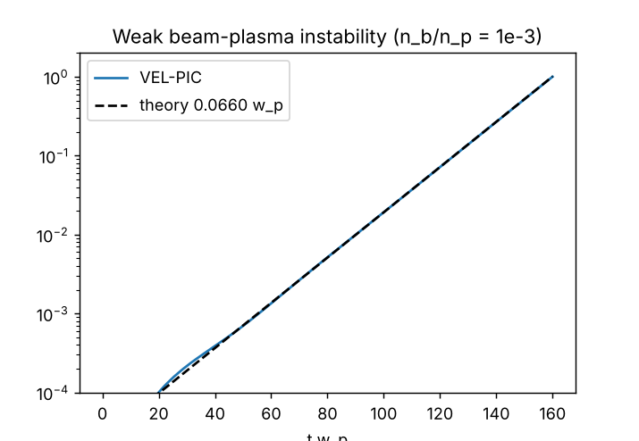

## 08. Thermionic and Fowler-Nordheim emission with self-consistent space charge

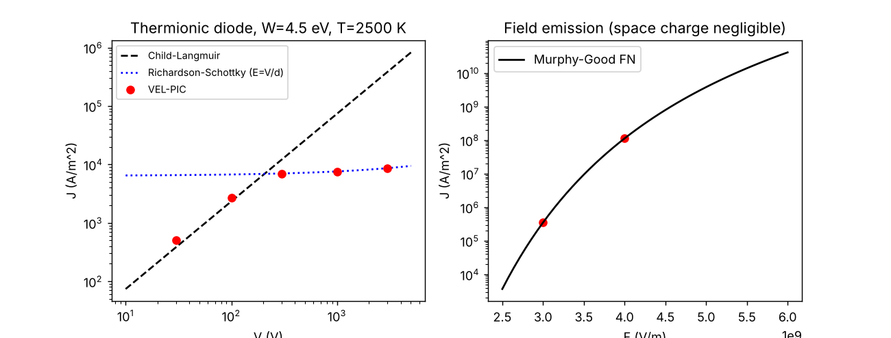

## 09. Hull cutoff in a planar crossed-field diode (ZY, magnetized)

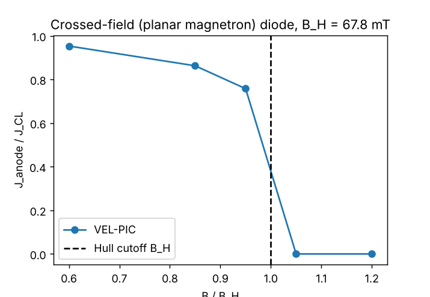

## 10. EM cavity eigenfrequencies (Yee FDTD, RZ and ZY)

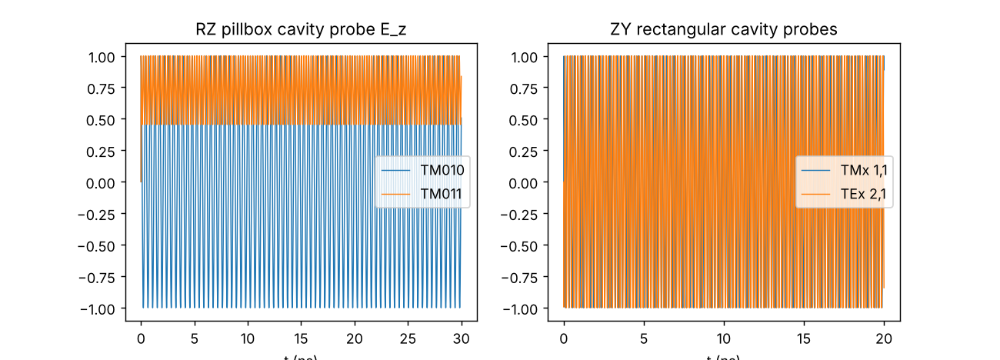

## 11. Graded absorbing boundary performance

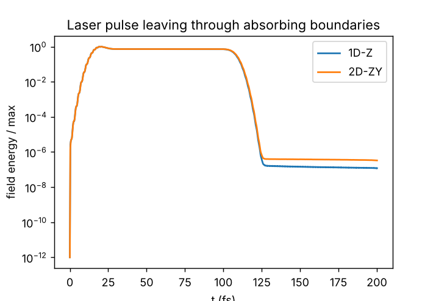

## 12. Charge conservation of the EM current deposition (Esirkepov)

## 13. Laser propagation in plasma: dispersion and critical-density reflection

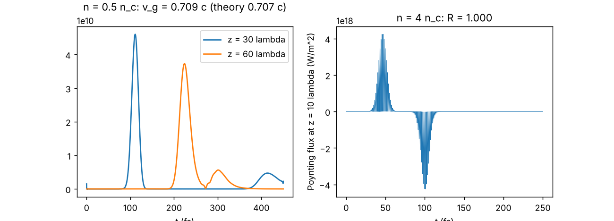

## 14. Relativistic beam-driven plasma wakefield amplitude (1D EM)

The ~5 % excess over linear theory is a weakly non-linear effect (n_b/n_p = 0.05); WarpX gives the same amplitude (benchmark 19).

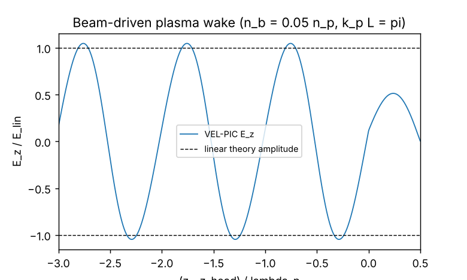

## 15. Space-charge beam transport (RZ): drift expansion & Brillouin solenoid

The solenoid case uses the paraxial (linear-field, constant beta_z) envelope model; the residual difference comes from the fringe-field non-linearity and rotation-induced axial slowing included in PIC. Envelope equation a'' = K/a - (eB/2 gamma m beta c)^2 a, K = 2I/(I_A beta^3 gamma^3)

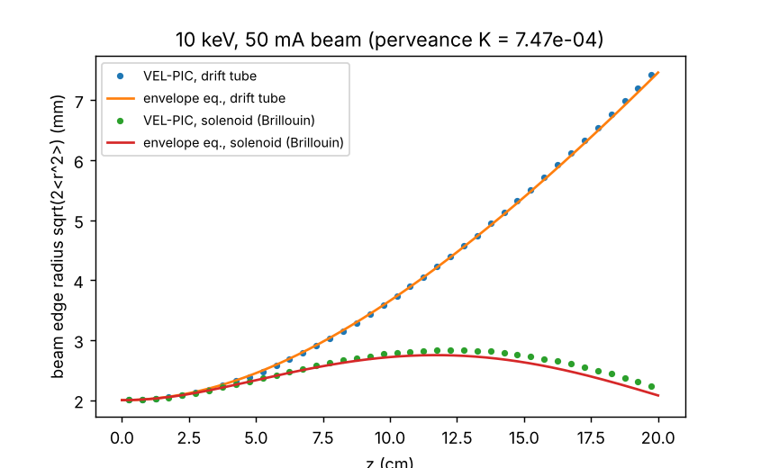

## 16. WarpX comparison A: 1D ES two-stream instability

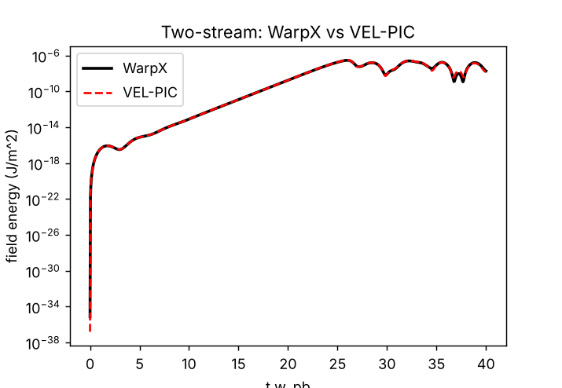

## 17. WarpX comparison B: 1D ES Pierce diode injected at J_CL

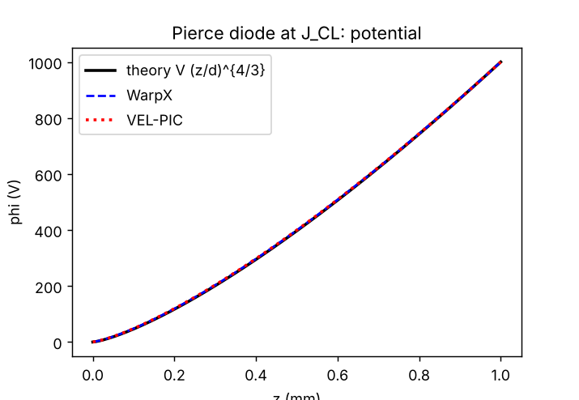

## 18. WarpX comparison C: RZ ES space-charge beam expansion

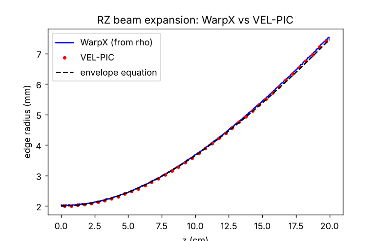

## 19. WarpX comparison D: 1D EM beam-driven plasma wakefield

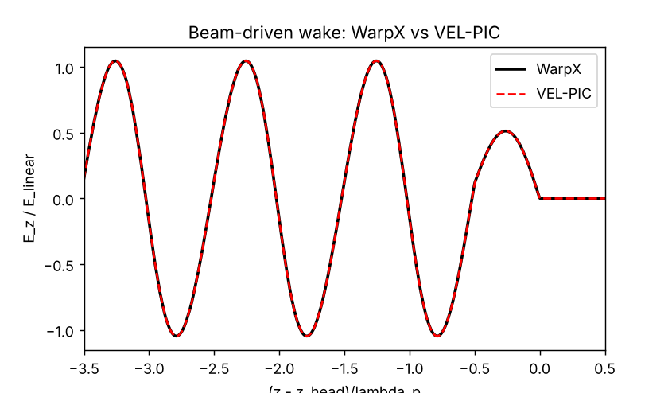

## 20. Parallel speed-up (numba threads / MPI), 2-core machine

Single-thread throughput: 7.88 M particle-steps/s (push + deposit + scikit-fem Poisson on 128x128).

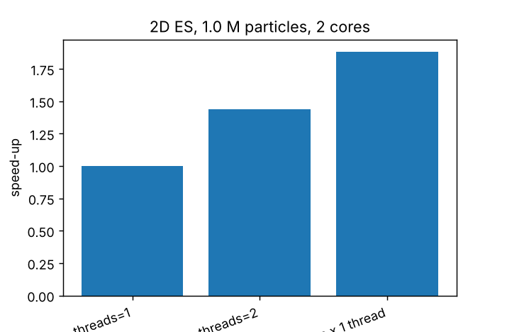

## 21. Vaned magnetrons (2D EM): A6 experiment and Hull / Buneman-Hartree window

A6 thresholds at 360 kV: smooth-bore Hull B* = 0.508 T (Lovelace-Ott), pi-mode BH field 0.825 T; the run at 0.8 T sits in the window. 2D result per metre of axial length x 7.2 cm: anode current 2.29 kA, port power 85 MW, electronic efficiency 10.3 %. Experiment (Bekefi & Orzechowski 1976): ~12 kA, ~1.7 GW at ~360 kV, ~0.8 T - the 2D model has no axial end loss and its output (loss port, loaded Q = 250) is not the experimental extraction, so current and power are indicative only; the frequency and mode are the benchmark. Planar magnetron at 170 kV: Hull field B_H = 0.150 T, pi-mode BH field 0.180 T (v_ph = 0.390 c); B = 0.16 T is inside the window (oscillates, f = 5.710 GHz), B = 0.19 T is above the BH field (V < V_BH: no oscillation, field rms ratio 0.004).

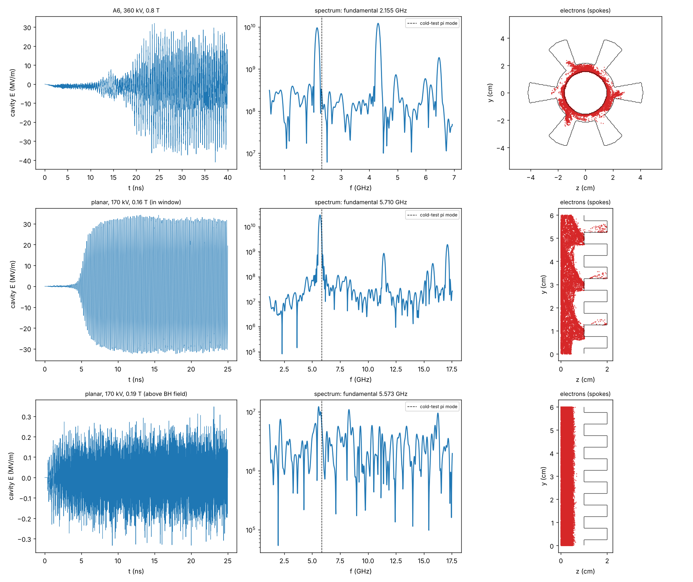

## 22. Relativistic beam self-fields: EM vs ES+self-B vs envelope (RZ)

Without the magnetic self-field (ES, no self-B) the beam blows up 1/(1-beta^2) = 3.9x faster; EM reproduces the 1/gamma^2 space-charge reduction. The beam current rises smoothly (sin^2, 1 ns) so that the TM modes of the drift tube are not rung by a step turn-on; edge radius measured at t = 3.5 ns.

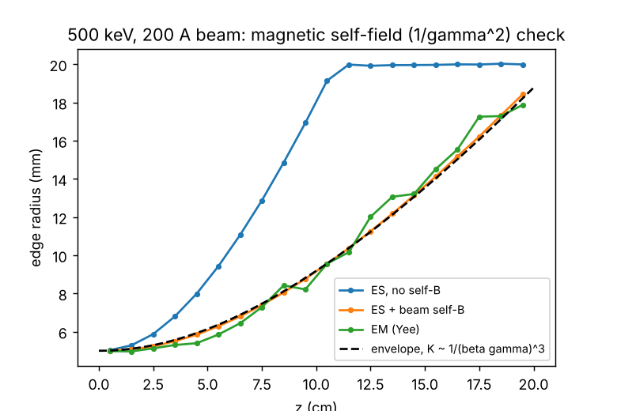

## 23. Loss port with defined loaded Q (cold-test ring-down)

The lossy load has sigma = 2 pi f eps0/(Q F); F (electric-energy fill factor) was calibrated with 'picstudio qcal' and the loaded Q re-measured here by an independent ring-down.

## 24. Lau et al. 2026: limiting current of small emitters (steady Eq. 7)

Strip array (planar) and circular patch (RZ), confined flow with injection energy Delta = E_in/eV. Finite-element Picard iteration with warm starts and bisection (threshold 1e-3 min(Delta, 1e-2)), tensor mesh refined across the emitter and graded towards the cathode.

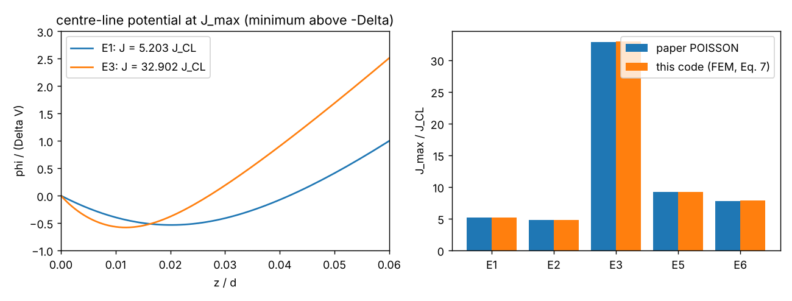

## 25. Lau et al. 2026: PIC onset of the virtual cathode at the steady J_max

Shipped examples yylau_2026_strip_caseA_zy and yylau_2026_disk_rz (z-only motion, refined mesh), injected current 4 % below / above the steady limit of Eq. (7). {"strip w/d=0.1 0.96": {"anode": 0.9999901523109243, "returned": -0.0}, "strip w/d=0.1 1.04": {"anode": 0.9126706932773107, "returned": 0.08854057247899176}, "disk R/d=0.1 0.96": {"anode": 0.999768672426319, "returned": -0.0}, "disk R/d=0.1 1.04": {"anode": 0.9586930023977178, "returned": 0.041010267985819915}}

## 26. Particle pushers: identical to WarpX (Boris, Vay, Higuera-Cary)

Single electron in uniform fields, WarpX 26.09 2D run (algo.particle_pusher, algo.maxwell_solver = none, ParticleExtrema reduced diagnostic every step) against VEL-PIC's push kernels with the same initial half-step push-back. The WarpX inputs and outputs are stored in benchmarks/warpx_compare/data/pushers. In the relativistic E x B case the Boris pusher drifts sideways by 1.34e-04 of the path (its known error, identical in WarpX), whereas Vay and Higuera-Cary keep the particle on a straight line.

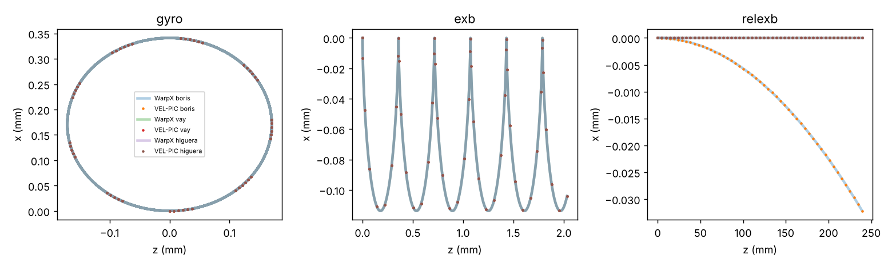

## 27. Landau damping and thermal Langmuir dispersion (1D ES)

Maxwellian electrons on a fixed neutralising background, 5% density perturbation (k lambda_D = 0.5) / 1% (k lambda_D = 0.3), quiet start in position and velocity, 64 cells per wavelength, References are the exact complex roots of the Vlasov-Poisson dispersion relation 1 + (1 + zeta Z(zeta))/(k lambda_D)^2 = 0: k lambda_D = 0.5 -> w = 1.4157 -0.1534i w_p; k lambda_D = 0.3 -> w = 1.1598 -0.0126i w_p (the fluid Bohm-Gross estimate sqrt(1 + 3 k^2 lambda_D^2) = 1.1269 is 3 % low at this k lambda_D; VEL-PIC gives 1.1614).

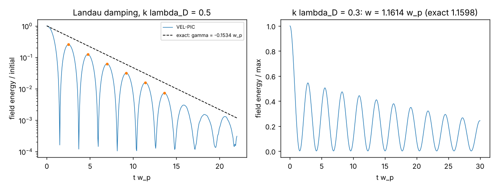

## 28. Electromagnetic wave dispersion in a cold plasma (1D EM)

Transverse velocity perturbation u_y = A sin(kz) in a periodic cold plasma; the transverse E at z = L/4 oscillates at w, compared with w^2 = w_p^2 + c^2 k^2.

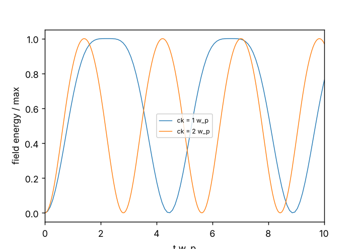

## 29. Energy conservation of a thermal plasma (1D EM, dz = lambda_D)

64 cells of one Debye length, 64 particles per cell, T = 100 eV. Total energy change: energy-conserving +0.00 %, momentum-conserving +0.14 % (grid heating), energy-conserving with WarpX's 1-pass bilinear J filter -0.02 %.

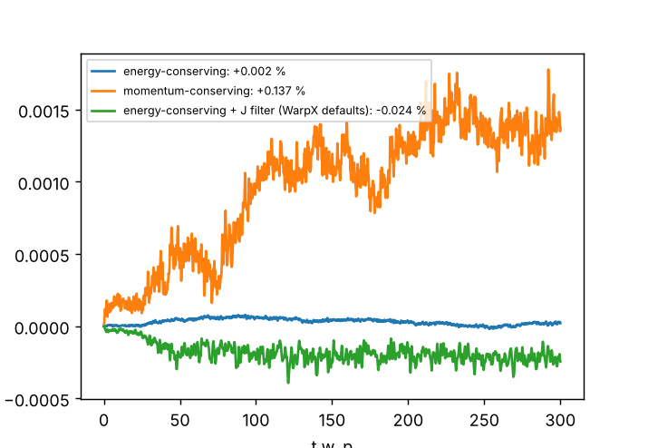

## 30. WarpX comparison E: planar smooth-bore magnetron gap (2D), below / above Hull cutoff

V = 10 kV, d = 5 mm, Hull field B_H = 67.77 mT (relativistic planar). Electrons injected at J = 0.25 J_CL with 2 eV normal energy, periodic 8-cell strip along the cathode. WarpX 26.09 2D (XZ, ES labframe, use_filter = 0) vs VEL-PIC 2D-ZY, same dt, shape, pusher and energy-conserving gather. Above B_H all electrons return to the cathode (twice the charge in the gap, the potential depressed near the cathode). Compared after the start-up, t = 1-2.2 ns, while the insulated hub is still laminar (later it develops the 2D diocotron/turbulent hub in both codes).

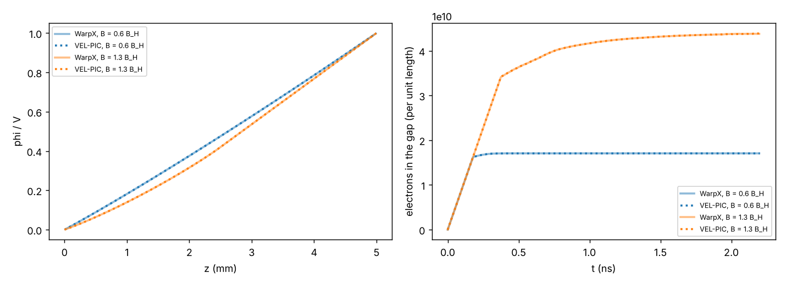

## 31. WarpX comparison F: cylindrical smooth-bore magnetron gap (RZ), below / above Hull cutoff

Coaxial gap, inner cathode a = 5 mm, anode b = 10 mm, V = 10 kV, axial B. Hull field B* = (m c / e d_e) sqrt(gamma^2 - 1), d_e = (b^2 - a^2)/(2b) (Lovelace & Ott 1974) = 90.36 mT. Electrons injected radially at J = 0.25 J_CL(b - a), 2 eV. WarpX 26.09 RZ (r_min = a, ES labframe) vs VEL-PIC 2D-RZ (annular domain).

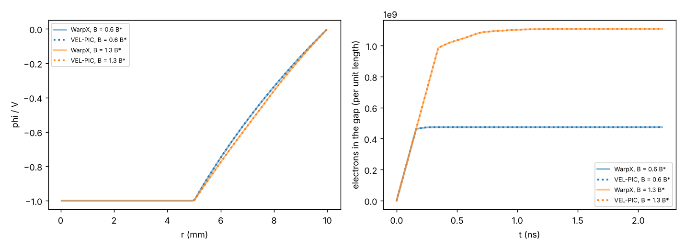

## 32. Pierce diode instability (1D ES, planar) vs the exact dispersion relation

Cold beam injected into a grounded gap with an immobile neutralising background, alpha = w_p L / v0. alpha = 1.5 pi: exact w = 0.0000 +0.7657i v0/L, PIC growth 0.7493; alpha = 2.5 pi: exact w = 1.4289 +0.5892i v0/L, PIC growth 0.5572, frequency 1.4130. The determinant root also reproduces the classical stability map (no growing root for alpha < pi, purely growing for pi < alpha < 2 pi, stable again near alpha = 2.9 pi).

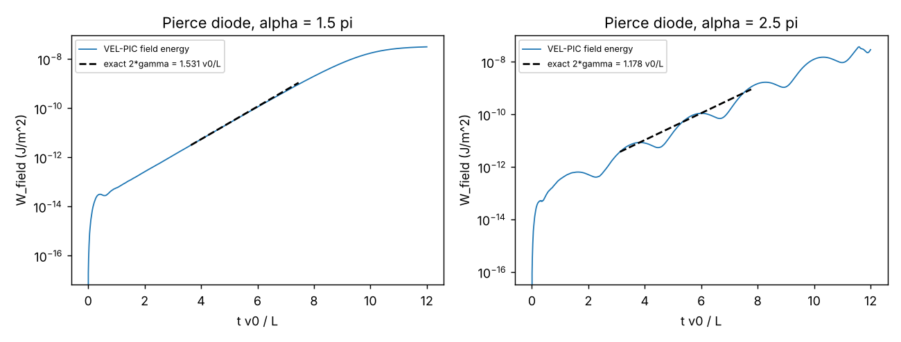

## 33. Cylindrical Hull cutoff of a smooth-bore (coaxial) magnetron diode (RZ)

Inner cathode r_c = 5 mm, anode r_a = 10 mm, V = 10 kV, axial B, SCL emission. Lovelace-Ott: d_e = (r_a^2 - r_c^2)/(2 r_a) = 3.75 mm, B* = 90.36 mT (the planar formula with d = r_a - r_c would give 67.77 mT). Anode current / I(B=0) at B/B* = [0.8, 0.9, 0.95, 1.05, 1.1, 1.2]: [0.8611, 0.8043, 0.7552, -0.0, -0.0, -0.0].

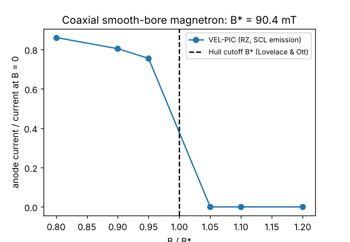

## 34. Space-charge-limited emission with the EM (Yee) solver: planar and cylindrical

Electrodes held at their potentials (ideal voltage sources, fields/circuit.py); Gauss-law emitter with the half-cell surface-charge correction. 1D 100 cells: J/J_ref = 1.0310, returned current -0.00e+00; 1D 200 cells: J/J_ref = 1.0194, returned current -0.00e+00; coax: I/L = 27104.0 A/m, Langmuir-Blodgett 26252.5 A/m. The Gauss-law emitter converges at first order in the cell size near the cathode, as in the ES solver.
