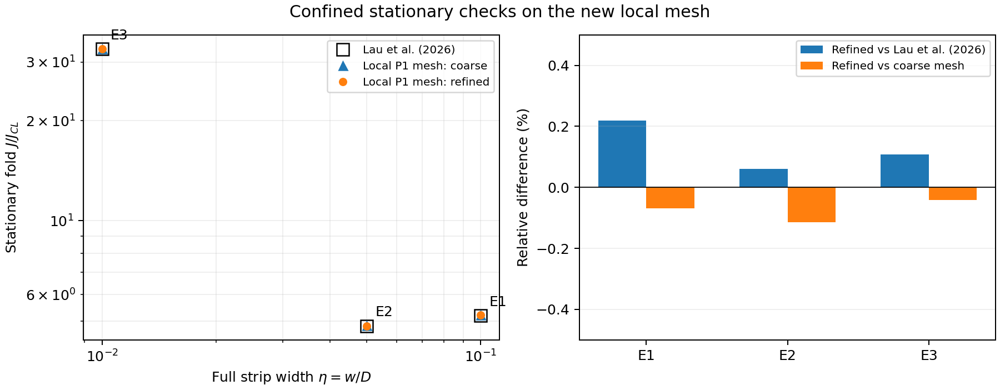
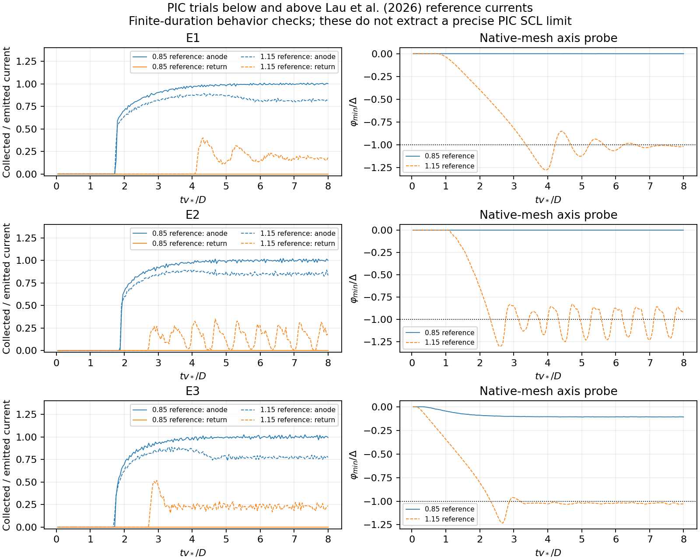

# Local electrostatic mesh verification

Actual computations in the `tfgpu` Python environment, 23 October 2026. The original z/y and EM/Yee paths remain selected unless an enabled `local 2D` region is present.

## Emitter-boundary localization correction, 23 October 2026

The emitter endpoint now splits only its boundary leaf fan, rather than inserting a full-domain axis break. The enabled cathode-return rectangle still refines its requested region, buffer, and graded transition. The interface displays **Along z**, **Along y**, and **2D**; saved JSON values are unchanged. Rectangle/polygon selection remains in the **Region shape** dropdown; the separate drawing buttons were removed.

The installed `tfgpu` test suite passed **29 tests**, including exact local endpoint insertion on all four boundaries, no change to the background leaf distribution, periodic pairing of added endpoints, and conserved cut-element strip integration. The offscreen GUI check verified labels, saved-value compatibility, conditional fields, removed buttons, and the actual mesh preview. The stationary validator now clips source quadrature at the strip edge when triangles cross it; it does not count a whole triangle based on its centroid.

Fresh refined stationary results after this correction:

| Case | Lau et al. (2026) | Corrected-mesh P1 fold | Error | Nodes | Triangles |
|---|---:|---:|---:|---:|---:|
| E1 | 5.191 | 5.201712045180348 | +0.206358% | 17,741 | 35,056 |
| E2 | 4.829 | 4.831585379690081 | +0.053539% | 15,742 | 31,063 |
| E3 | 32.863 | 32.90453535768107 | +0.126389% | 13,275 | 26,128 |

Each result has independently converged neighbors on both sides of the maximum. Raw branches, peak brackets, models and native potentials are in `benchmarks/local_mesh_results/emitter_endpoint_fix/`. These are finite-mesh stationary checks, not newly measured time-dependent PIC limits. Reproduce with `python benchmarks/local_mesh_stationary.py --fine --out benchmarks/local_mesh_results/emitter_endpoint_fix_recheck`.

## Earlier baseline verification

The following figures, tables and PIC histories were calculated before emitter-boundary localization and are retained as the earlier baseline. They are not substituted for the fresh results above.

## Stationary comparison with Lau et al. (2026)

Table 1 POISSON reference values; full strip width is eta=w/D. A separate reflection-free stationary calculation uses the actual new P1 mesh and Poisson stiffness. It integrates the monoenergy source with fifth-order Duffy/Gauss quadrature, follows potential-amplitude bordered Newton continuation, and accepts a fold only with converged states on both sides of its current maximum. This is independent of the time-dependent PIC runs below.

| Case | eta | Delta | p/D | Lau et al. (2026) | Refined local P1 fold | Error | Mesh change |
|---|---:|---:|---:|---:|---:|---:|---:|
| E1 | 0.1 | 0.01 | 5.12 | 5.191 | 5.202329967 | +0.2183% | -0.0682% |
| E2 | 0.05 | 0.001 | 2.56 | 4.829 | 4.831919312 | +0.0605% | -0.1146% |
| E3 | 0.01 | 0.01 | 2.048 | 32.863 | 32.898455629 | +0.1079% | -0.0423% |

All three refined stationary errors are below 0.3%. Refinement reduced each error. These are finite-mesh results, not a proof of continuum convergence to the final digit.



## PIC behavior checks

Each geometry was run at 0.85 and 1.15 times its reference current, with dt*v*/D=0.004 and final t*v*/D=8. The second half of the run supplies the reported current averages. The current fractions need not add to exactly one over a finite window because the charge remaining in the gap changes. The last potential minimum is instantaneous; oscillatory cases cannot be characterized by that value alone.

| Case | Injected/reference | Anode/emitted | Cathode return/emitted |
|---|---:|---:|---:|
| E1 | 0.85 | 0.99291 | 0.00000 |
| E1 | 1.15 | 0.83672 | 0.19739 |
| E2 | 0.85 | 0.99637 | 0.00000 |
| E2 | 1.15 | 0.85344 | 0.15522 |
| E3 | 0.85 | 0.99706 | 0.00000 |
| E3 | 1.15 | 0.77838 | 0.22681 |

Below-reference runs had no recorded cathode return. Above-reference runs produced return current. This brackets broad behavior only: the PIC runs do not establish a 0.3%-accurate PIC current limit. Every run kept its mesh fixed. Relative assembled Poisson residuals were below 5e-12; relative deposited-charge errors were below 3e-16.



## Reproduction

Run from the VEXPACE source folder with the `tfgpu` Python interpreter:

```bash
python benchmarks/check_local_mesh_lau2026.py
python benchmarks/local_mesh_stationary.py
python benchmarks/local_mesh_stationary.py --fine --out benchmarks/local_mesh_results/stationary_fine
```

Inputs, histories, mesh/native-field arrays, stationary branch points, converged peak brackets and CSV are under `benchmarks/local_mesh_results/`. Separate output folders are needed when changing numerical settings.

## Numerical and interface checks

- Positive, conforming triangles cover the full rectangle without interior cracks or silent element deletion.
- Barycentric interpolation reproduces an affine field; deposition conserves charge and is the adjoint of potential interpolation.
- Uniform vacuum fields and electrode reactions match analytical values in ZY and RZ; periodic boundaries are paired exactly.
- A manufactured Poisson solution decreases in error under refinement; the mass-weighted L2 error fell from 1.202e-3 to 3.930e-4 to 1.085e-4 over three levels.
- Both direct-P1 and mass-projected field-gathering options execute short PIC runs.
- Native triangle fields are saved and plotted; the rectangular compatibility samples are not used as the particle source or self-field.
- GUI rectangle/polygon drawing, settings selection, mesh preview and EM rejection were exercised.
- The installed test suite passed 23 tests. MPI execution and long-duration plasma/EM validation were not newly benchmarked by this addition.

Numerical design reference: [Finite Element Particle in Cell (FEM-PIC), Particle In Cell Consulting](https://www.particleincell.com/2015/fem-pic/). Its discussion of shape-function weighting, point location and constant P1 element gradients informed the checks; its ion/Boltzmann-electron example is not substituted for this electron-diode physics.
